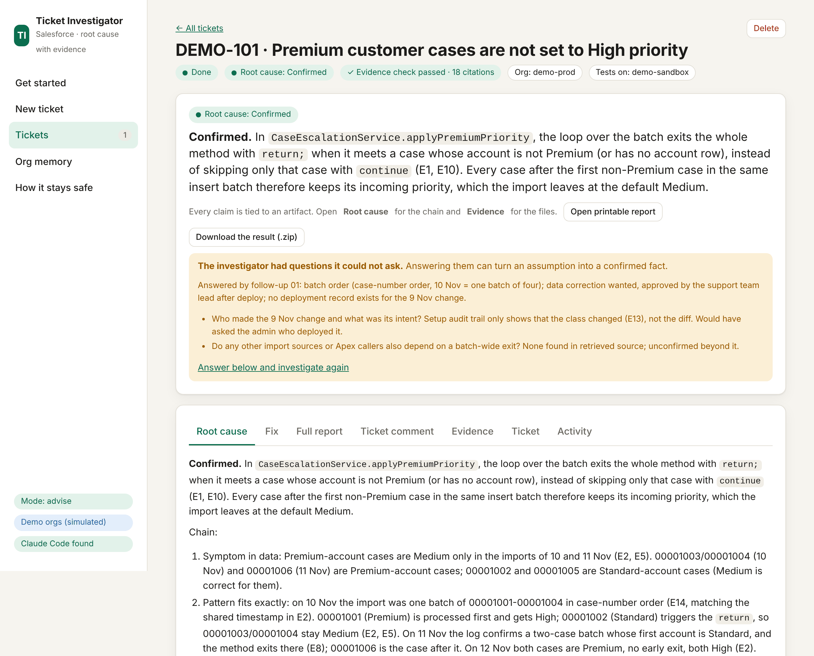
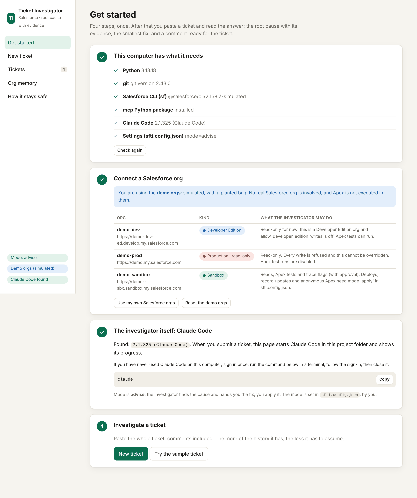
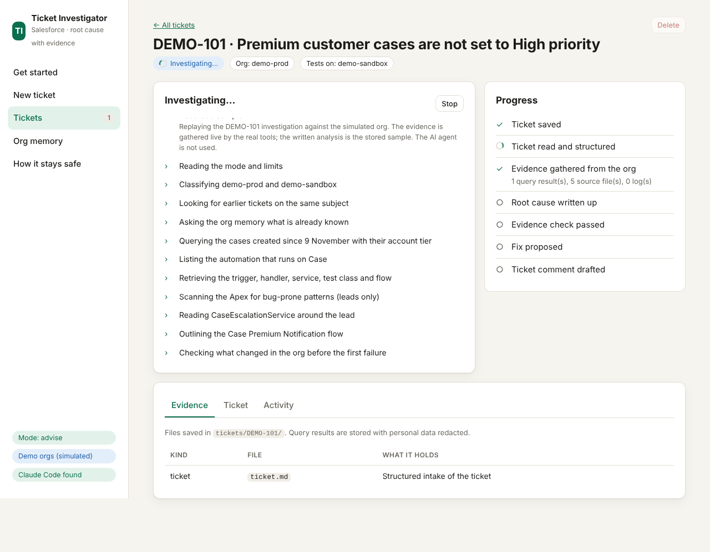
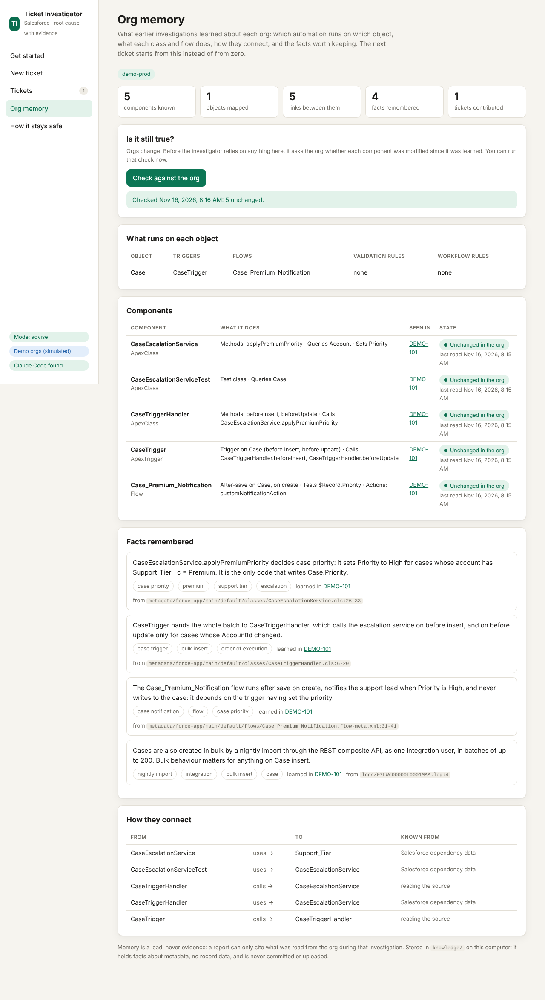

# Salesforce Ticket Investigator

Paste a Salesforce bug ticket into Claude Code. The investigator saves it in a structured form,
finds the root cause **with evidence** (a file and line, a saved query result, a debug log line),
proposes the smallest correct fix as a diff, and writes a report and a draft ticket comment.
With your approval it can also deploy the fix to a sandbox, test it and roll it back.

Production orgs are read-only. That is enforced in code and has no override.

Supported systems: **Windows and macOS.** Linux is not a supported system: it happens to work
(the tool was built on it) but is no longer tested in CI.

**The quickest way to see it:** after installing (three commands, below), run

```
python -m webapp --demo
```

A page opens in your browser. It checks your set-up, lets you paste a ticket, shows the
investigation as it happens and then the result. `--demo` uses simulated orgs with a planted
bug, so you need no Salesforce account to try it.



- [The web interface](#the-web-interface)
- [Org memory: it learns your org](#org-memory-it-learns-your-org)
- [What you get](#what-you-get)
- [Try it in five minutes, without a Salesforce org](#try-it-in-five-minutes-without-a-salesforce-org)
- [Set it up for a real org](#set-it-up-for-a-real-org)
- [The two modes](#the-two-modes)
- [Safety model](#safety-model)
- [Permission settings and the guard](#permission-settings-and-the-guard)
- [Tool reference](#tool-reference)
- [The demonstration: DEMO-101](#the-demonstration-demo-101)
- [What was verified, and what was not](#what-was-verified-and-what-was-not)
- [Troubleshooting](#troubleshooting)
- [Optional: reading tickets from Jira (Phase 5)](#optional-reading-tickets-from-jira-phase-5)
- [Using `core/` from another project](#using-core-from-another-project)
- [Tests](#tests)

## What you get

| Piece | What it is |
|---|---|
| `core/` | All Salesforce logic, every safety check, and the org memory. Standard library only. |
| `mcp_server/` | A thin MCP server (`sf-investigator`) with 36 read-only tools and 6 write tools. |
| `webapp/` | The local web interface (`python -m webapp`). Standard library only. |
| `.claude/` | Five skills (get started, intake, investigate, propose fix, write comment), a read-only `code-tracer` subagent, permission settings and a guard hook. |
| `CLAUDE.md` | The rules the assistant follows in this folder. |
| `simulator/` | A stand-in for the `sf` executable backed by files, with three simulated orgs. It powers the tests and the zero-setup demo. It does not execute Apex. |
| `samples/` | A sample ticket (`DEMO-101`), the planted bug behind it, and the report the investigation produced. |
| `tests/` | The test suite. It needs no org and no Salesforce CLI. |

Each ticket gets its own folder, `tickets/<KEY>/`, which is never committed to this repository:

```
tickets/<KEY>/
  ticket.md        structured intake
  attachments/     files you drop in
  metadata/        SFDX project with its own git repository (every retrieve is a commit)
  queries/         saved query and test results (always redacted)
  logs/            downloaded debug logs
  apex/            anonymous Apex scripts and their logs (apply mode)
  fix.diff         proposed change
  report.md, report.html, comment.md
```

## The web interface

```
python -m webapp            # your real Salesforce CLI and orgs
python -m webapp --demo     # simulated demo orgs, no Salesforce account needed
python -m webapp --port 9000 --no-browser
```

It opens `http://127.0.0.1:8765/`. Stop it with Ctrl+C.

| Page | What you do there |
|---|---|
| **Get started** | Four steps. It checks Python, git, the Salesforce CLI and Claude Code and, for anything missing, shows the command that installs it on your system. It lists your connected orgs with what each one is (production, sandbox…). To connect one, you type a name, pick the kind of org, and copy the exact `sf org login web …` command it builds. |
| **New ticket** | Paste the ticket as it is, comments included. The key is found in the text. Choose the org where the problem happens and, if you have one, a sandbox for tests. |
| **The ticket page** | Start the investigation and watch it: each step in plain words ("Querying records", "Reading source", "Checking the report's evidence"). Then the result: the root cause and whether it is confirmed, the evidence check, and tabs for the cause with its evidence chain, the fix as a diff with the test plan, the full report, the draft comment with a copy button, the saved evidence files, and the ticket as it was read. |
| **Tickets** | Everything investigated on this computer, with status and root-cause state. |
| **Org memory** | What has been learned about each org, and a button to check it against the org. See below. |



### How an investigation runs from the page

The investigation itself is done by Claude Code. The page has three ways to get there:

1. **Investigate with Claude Code.** The page starts Claude Code in the project folder without a
   terminal (`claude -p`, with the ticket's instructions on standard input) and shows its
   progress. It uses your Claude Code sign-in and usage. A typical ticket takes a few minutes.
2. **Run it yourself.** The page shows one prompt to paste into Claude Code. The result appears
   on the page as the files are written, because the page reads the ticket's folder.
3. **Replay the recorded sample** (demo orgs, sample ticket only). Shows a complete result in
   seconds without the AI: the real tools gather the evidence from the simulated org, and the
   written analysis is the stored sample. The page labels it as a recorded sample.

**Do this once before using option 1:** open a terminal in the project folder, run `claude`, sign
in if asked, and answer yes when it asks whether you trust the folder. Until a folder is trusted,
Claude Code ignores the project's permission list when it runs without a terminal, and the
investigator's tools would all be refused. The page detects this and tells you.

**From the page the investigator only advises.** Started this way, nobody is there to approve
anything, so every tool that changes an org is refused, whatever the mode in `sfti.config.json`.
You get the fix as a diff. To have it deployed to a sandbox and tested, use Claude Code itself in
`apply` mode, where each write asks you.



### What the page can and cannot do

- It answers only on this computer: it binds to `127.0.0.1`, refuses requests addressed to any
  other host name, and requires a token embedded in the page for anything that changes state.
  There is no option to expose it on the network. Do not put it behind a public proxy.
- It has **no route that changes a Salesforce org**. It reads (orgs, tickets, memory), creates
  and deletes ticket folders on your disk, and starts investigations. A test scans its code for
  any reference to the write functions.
- It posts nothing to your ticket system. The comment tab is a draft with a copy button.
- Pasted ticket text is stored as you pasted it in `tickets/<KEY>/attachments/`, on your disk
  only. The structured `ticket.md`, the report and the comment are written without personal data.

## Org memory: it learns your org

Every investigation reads parts of an org. The investigator keeps what it saw, so the next ticket
on the same org starts from knowledge instead of from zero.

**What is remembered**, per org, in `knowledge/<org id>.json` on your computer:

| | Where it comes from |
|---|---|
| **Components**: every class, trigger and flow that was retrieved, with what it does: its methods, the objects it queries, the fields it sets, what it calls; for a flow, when it runs and which fields it tests or writes | Automatically, each time source is retrieved |
| **Objects**: which triggers, flows, validation rules and workflow rules run on each object | Automatically, when the automation on an object is listed |
| **Links**: which component calls or uses which | Automatically, from the source and from Salesforce's dependency data |
| **Facts**: short notes such as "CaseEscalationService decides case priority from the account's support tier" or "cases are also created in bulk by a nightly import", with topics and the file they were read from | Written by the investigator at the end of a ticket |

**How it is used.** At the start of a ticket the investigator asks the memory about the ticket's
subject ("voice calls", "case priority"…). It gets back the components and facts that relate, and
goes to them first instead of rediscovering the org.

**The double check.** Orgs change, so nothing is trusted because it was true last month:

- When memory is recalled, the org is asked for the current last-modified date of every
  remembered component involved. Anything modified since it was learned is flagged **changed**,
  the facts about it are flagged **needs re-reading**, and the investigator reads it again.
- When source is retrieved, it is compared with what was remembered. A difference is reported
  ("changed since last seen in ticket ABC-12") and the memory is updated.
- A component that no longer exists is reported as such.
- **Memory is a lead, never evidence.** A report may only cite what was read from the org during
  that investigation. The memory decides where to look first; it never appears as proof.

**What it does not hold:** no record data, no personal data (a note containing an email address
is refused), no conclusions about individual tickets. It is keyed by org Id, not by alias, so
re-pointing an alias does not mix two orgs. The folder is never committed or uploaded.

The **Org memory** page shows all of it, with a "Check against the org" button. In Claude Code
the tools are `recall_org_knowledge`, `org_map`, `verify_org_knowledge`, `remember_org_fact` and
`forget_org_fact`.



Limits to know: the change check uses last-modified dates for Apex classes, triggers and flows;
other component types are compared only when they are retrieved again. The "what it does"
outline is read from the source text with simple rules, so it can miss things (dynamic calls,
for instance). Both are reasons the memory is treated as a lead.

## Try it in five minutes, without a Salesforce org

The steps below use Claude Code directly. With the web interface the same thing is:
install (step 1), then `python -m webapp --demo`, then **Try the sample ticket**.


You need Python 3.11 or newer, git and Claude Code. The simulated orgs contain a planted bug and a
ticket about it.

**1. Install.** From the project folder:

macOS:

```bash
python3 -m venv .venv
source .venv/bin/activate
python -m pip install -e ".[dev]"
```

Windows (PowerShell):

```powershell
py -m venv .venv
.\.venv\Scripts\Activate.ps1
python -m pip install -e ".[dev]"
```

**2. Create the simulated orgs.**

```
python -m simulator setup
```

It prints the path of a launcher and the line to set `SFTI_SF_EXECUTABLE`. Set it in the same
terminal:

macOS:

```bash
export SFTI_SF_EXECUTABLE="$PWD/simulator/state/bin/sf"
```

Windows (PowerShell):

```powershell
$env:SFTI_SF_EXECUTABLE = "$PWD\simulator\state\bin\sf.cmd"
```

**3. Check the prerequisites.**

```
python -m core.prereqs
```

Every line should say `OK`. The Salesforce CLI line shows `…-simulated` and three orgs are listed:
`demo-sandbox`, `demo-prod`, `demo-dev`.

**4. Start Claude Code from the same terminal**, in this folder, so that it inherits the virtual
environment and `SFTI_SF_EXECUTABLE`:

```
claude
```

Approve the `sf-investigator` MCP server when asked. `/mcp` should show it as connected.

**5. Paste the sample ticket.** Open `samples/DEMO-101/ticket.txt`, copy all of it, paste it into
Claude Code and add: *"New ticket. Investigate it on demo-prod; demo-sandbox is available."*

The assistant should save `tickets/DEMO-101/ticket.md`, summarize the ticket back with its
ambiguities, investigate, and produce `report.md`, `report.html`, `comment.md` and `fix.diff`.
Compare them with `samples/DEMO-101/expected/`.

When you are done, unset `SFTI_SF_EXECUTABLE` (or open a new terminal) to go back to the real
Salesforce CLI.

## Set it up for a real org

**1. Prerequisites.**

| Need | Check | Install |
|---|---|---|
| Python 3.11+ | `python --version` | python.org, or your package manager |
| git | `git --version` | git-scm.com |
| Salesforce CLI | `sf --version` | `npm install --global @salesforce/cli` |
| Claude Code | `claude --version` | see the Claude Code documentation |

**2. Install the project** as in step 1 above (`python -m pip install -e ".[dev]"`).

**3. Tell the project which Python to use, if needed.** `.mcp.json` starts the server with
`${SFTI_PYTHON:-python}`, and the guard hook uses the same variable.

- If you start Claude Code from a terminal where the virtual environment is active, `python` is
  the right one and you have nothing to set.
- Otherwise set `SFTI_PYTHON` to the full path of the environment's interpreter, for example
  `export SFTI_PYTHON="$PWD/.venv/bin/python"` (macOS) or
  `$env:SFTI_PYTHON = "$PWD\.venv\Scripts\python.exe"` (Windows).
- On a Mac that only has `python3`, set `SFTI_PYTHON=python3`.

**4. Log in to your orgs** with the Salesforce CLI, in your own terminal (the assistant never runs
`sf` itself):

```
sf org login web --alias my-sandbox --instance-url https://test.salesforce.com
sf org login web --alias my-prod
```

Log in to production with a user that has only the access the investigation needs. The tool
never writes to production, but a read-only or minimum-access user is still the right habit.

**5. Check.**

```
python -m core.prereqs
```

**6. Start Claude Code in this folder** and paste a ticket. Tell it which org alias to use.

### How to try each part

| Part | Ask the assistant | What to look for |
|---|---|---|
| Guards and org check | "Which orgs do I have, and which are production?" | `org_info` reports the classification and `writes_allowed` |
| Intake | Paste a ticket | `tickets/<KEY>/ticket.md`, a summary, a list of ambiguities, at most a few questions |
| Read-only investigation | "Investigate it on `<alias>`" | Hypotheses, then queries, retrieved source, logs; files under `queries/`, `metadata/`, `logs/` |
| Report | (follows the investigation) | `report.md` passes `validate_report`; every claim has an E-number; `comment.md` |
| Fix proposal | "Propose the fix" | `fix.diff`, rationale, impact, risks, test plan. Nothing is deployed |
| Apply and verify | Switch to apply mode (below), then "apply it on `<sandbox alias>`" | A prompt for each write; validate, deploy, tests, re-check, rollback on request |

## The two modes

The mode is the `mode` key in `sfti.config.json`. **You** change it; the assistant is not allowed
to edit that file. It is re-read on every operation, so no restart is needed.

| Mode | What the assistant does |
|---|---|
| `advise` (default) | Finds the root cause and hands you the fix as a diff with a test plan. You implement it. The only write available is `set_trace_flag`, on a non-production org, with your approval. |
| `apply` | The same, and then, with your approval for every single write: deploys to a non-production org, runs tests, re-checks records or logs, iterates, and rolls back if the fix does not hold. |

All settings, with their defaults:

```json
{
  "mode": "advise",
  "allow_developer_edition_writes": false,
  "allow_apex_tests_on_production": false,
  "default_row_limit": 50,
  "max_row_limit": 200,
  "jira_base_url": ""
}
```

- `allow_developer_edition_writes`: Developer Edition orgs report `IsSandbox = false`. They are
  read-only unless you set this to `true`.
- `allow_apex_tests_on_production`: Apex test runs are refused on production. Setting this to
  `true` enables one separate tool, `run_apex_tests_on_production`, which asks for approval every
  time. It enables test runs only. It does not enable any write.
- `default_row_limit`, `max_row_limit`: a query without `LIMIT` gets the default; a `LIMIT` above
  the maximum is rejected. The maximum cannot be set above 2000.
- `jira_base_url`: see [Phase 5](#optional-reading-tickets-from-jira-phase-5). Empty means off.

A file that cannot be read, or a value of the wrong type, falls back to the safe defaults, and
`get_config` reports the problem. Nothing in this file can enable writes on production.

## Safety model

Three independent gates stand in front of every write to an org:

| Gate | Where | What it does | Can it be switched off? |
|---|---|---|---|
| 1. Org classification | `core/org_guard.py`, `core/sf_cli.py` | Reads `Organization.IsSandbox` and `OrganizationType` live before every write. Anything that is not provably a sandbox, a scratch org or a Developer Edition org is production, including an org that cannot be inspected. Production is refused. | No. There is no parameter, setting or environment variable. |
| 2. Mode | `sfti.config.json` | Deploys, record updates, anonymous Apex and rollbacks need `apply`. | By you, in the config file. |
| 3. Approval | `.claude/settings.json` | Every write tool is in the `ask` list: Claude Code shows the tool and its exact arguments and waits for you. | Only by changing the settings or running Claude Code with permission prompts bypassed. |

How gate 1 is made structural rather than a convention:

- `core/sf_cli.py` classifies every `sf` command before running it. A fixed allowlist of read
  commands, with the exact flags allowed on each, runs freely. **Everything else is a write**,
  including commands the wrapper has never seen.
- A write runs only with a permit. Permits are issued only by `org_guard`, only for an org that
  classifies as non-production, are bound to that one org, and cover a fixed number of commands.
  The permit class itself refuses to be created for a production classification.
- Every attempt is written to a local audit log (`audit/audit.db`, not committed), including the
  blocked ones. `audit_log` and `list_changes` show it.

Other guards in `core/`:

- **Secrets.** Access tokens and similar fields are stripped from everything the CLI returns
  before it is returned, logged or put in an error.
- **Row limits and read-only queries.** Only a single `SELECT` runs. `FOR UPDATE` is refused.
- **Redaction.** Values of fields that look like personal data (email, phone, address, birthdate,
  names on Contact, Lead and User, and more) are replaced with `[REDACTED]`. `reveal_fields` shows
  a value in the chat when the value itself is the bug; files saved under `queries/` stay redacted
  regardless.
- **Path confinement.** File tools only read inside `tickets/<KEY>/`, and never inside `.git`.
- **Report check.** `validate_report` fails a report whose citations do not resolve to a real
  file and line, whose confirmed root cause cites no evidence, or which contains an email address.
- **Nothing is posted.** No tool sends anything to a ticket system, chat or email. The optional
  Jira reader only sends `GET` requests.

### The hook, and what it does not guarantee

`.claude/hooks/guard.py` is a PreToolUse hook, installed by the committed
[permission settings](#permission-settings-and-the-guard). It blocks three things:

1. running `sf` or `sfdx` directly from Bash (also through `npx`, a path, or after `&&`);
2. calling the core write functions from a Python one-liner in Bash, which would skip the
   approval prompt;
3. editing `sfti.config.json`, `.mcp.json`, `.claude/settings.json`, `.claude/hooks/` and the
   audit database.

It is **pattern matching, not a sandbox**. It stops mistakes and shortcuts; a determined attempt
to disguise a command can get past it. It also has one known false positive: a Bash command that
both reads a `.py` file and names a write function (for example
`grep deploy_component core/changes.py`) is blocked. The hard guarantee, no writes to production,
is gate 1 above and does not depend on the hook.

The hook is built so that it cannot lock a session: the command does nothing when the script is
missing, and the script exits 0 on any internal error.

### If you run Claude Code with permission prompts bypassed

Gate 3 disappears: write tools no longer wait for you. Gates 1 and 2 are unaffected, so
production stays read-only and advise mode still refuses fix-applying writes. Do not combine
bypassed permissions with `apply` mode unless the only non-production orgs you are logged in to
are ones you are happy to see changed without being asked.

## Permission settings and the guard

`.claude/settings.json` holds the generator's output for the MCP server's own tool lists
(`scripts/generate_settings.py`), with the guard on. A test fails when the committed file and the
generator disagree.

| What | How it is set |
|---|---|
| Write tools | all 6 in `ask`: every call prompts |
| Read-only tools | all 36 in `allow` |
| Direct `sf` / `sfdx` in Bash | denied by permission rule and by the hook |
| Guard hook | installed for Bash, Edit and Write |
| Edits to `sfti.config.json`, `.mcp.json`, `.claude/settings.json`, `.claude/hooks/` | denied by permission rule and by the hook |
| Production write block, mode gate, redaction, limits | in `core/`, independent of these settings |

The guard applies to the assistant in this folder: it cannot edit those four safety files. You
can, in your own editor or terminal.

```
python scripts/generate_settings.py            # regenerate after adding or renaming a tool
python scripts/generate_settings.py --check    # is the committed file up to date?
python scripts/generate_settings.py --no-guard # same permission lists, no hook, no edit protection
```

Use `--no-guard` only while you want the assistant to work on the tool itself (its settings, its
hook or the config file), and regenerate with the guard afterwards.

How the guard came to be on: the session that finished the build was not permitted to write
`.claude/settings.json` and stopped there, leaving it to you. The session that started the build,
acting on your brief ("read-only tools allowed without prompting; every write tool set to always
ask"), then committed the file. It could not run the generator, so the file was written by hand
to equal its output; the test above confirms the content is equal. If `--check` reports a
difference in formatting, run the generator once. See decisions 19 and 43 in
[`docs/DECISIONS.md`](docs/DECISIONS.md).

Since then the file has been regenerated once by the generator itself, with the owner's explicit
go-ahead, to add the five org-memory tools to the `allow` list (decision 52). Nothing else in it
changed.

## Tool reference

Read-only tools run without a prompt. Paths in results are relative to `tickets/<KEY>/`.

| Tool | Purpose |
|---|---|
| `get_config` | Mode, row limits, optional switches |
| `list_orgs`, `org_info` | Authenticated orgs; classification of one org |
| `init_ticket`, `list_tickets`, `search_tickets` | Ticket folder; earlier tickets ("has this been seen before?") |
| `jira_get_ticket` | Optional, off by default: read one ticket from Jira Server / Data Center |
| `recall_org_knowledge`, `org_map`, `verify_org_knowledge` | The org memory: what earlier tickets learned about this org, searched by subject and checked against the org's current state |
| `remember_org_fact`, `forget_org_fact` | Save a fact about how the org is built, or remove one that no longer holds. Local files only |
| `retrieve_components` | Retrieve `Type:Name` components into the ticket's git repository (at most 50 per call) |
| `list_files`, `search_metadata`, `read_file` | List, regex-search and read what was retrieved, with line numbers |
| `summarize_flow` | Outline of a Flow: trigger, entry conditions, decisions, record operations, order |
| `scan_apex` | Bug-prone patterns in retrieved Apex. Leads, not findings |
| `describe_object` | Fields, record types, child relationships, and the automation on an object |
| `soql_query`, `tooling_query` | `SELECT` with enforced limits and redaction; saved as evidence when given a `ticket_key` |
| `find_dependencies` | What uses a component and what it uses. An empty list means "none recorded" |
| `recent_org_changes`, `record_history` | Setup audit trail and modified code in a time window; field history of one record |
| `list_debug_logs`, `get_debug_log`, `analyze_debug_log` | Logs: list, download with an excerpt, and analyze (code units, executed source lines, flow decisions, DML, SOQL, limits) |
| `run_apex_tests` | Run test classes on a non-production org |
| `workspace_diff` | Local edits as a unified diff against the org's version; saved to `fix.diff` |
| `evidence_index` | Every saved artifact of a ticket with a one-line description and the string to cite |
| `write_template`, `validate_report`, `validate_comment`, `export_report_html` | Report and comment: template, checks, HTML copy |
| `list_changes`, `audit_log` | What the tool changed, and every write attempt including the blocked ones |

Write tools ask every time and are refused on production:

| Tool | Mode | Notes |
|---|---|---|
| `set_trace_flag` | both | Diagnostic. Creates or extends a trace flag (and one debug level) for a user |
| `deploy_component` | apply | Commits your edit, snapshots the org's version, stops on drift, deploys, verifies, returns a `change_id`. Up to 5 components per call. `validate_only` for a check-only deploy |
| `rollback_change` | apply | Restores the snapshot of a `change_id` (or deletes a component the change created; or restores record values). Stops if the org changed again afterwards, unless `force` |
| `update_records` | apply | At most 10 records; previous values kept for rollback |
| `execute_anonymous_apex` | apply | Script and log are saved. Cannot be rolled back automatically |
| `run_apex_tests_on_production` | both | Only with `allow_apex_tests_on_production: true` |

### Calling a read-only tool from the command line

For debugging, without Claude Code:

```
python scripts/call_tool.py --list
python scripts/call_tool.py org_info org=demo-prod
python scripts/call_tool.py soql_query org=demo-prod query="SELECT Id, Priority FROM Case" limit=5
```

Write tools are refused there, always. They run only through Claude Code, where each call asks.

## The demonstration: DEMO-101

`samples/DEMO-101/ticket.txt` reports that some cases for Premium accounts are created with
Medium priority. The ticket's comments point at a flow. The investigation, run in advise mode
against the simulated orgs, is stored in `samples/DEMO-101/expected/`:

| File | What it is |
|---|---|
| `ticket.md` | The structured intake, with six ambiguities |
| `report.md`, `report.html` | The report: 19 evidence rows, 23 verified citations, root cause confirmed |
| `comment.md` | The draft ticket comment |
| `fix.diff` | One changed statement and one new test method |
| `apply-loop-transcript.txt` | The apply-mode loop on the simulated sandbox |

The root cause it reaches: `CaseEscalationService.cls` line 30 is `return;` inside the loop over
the trigger batch, so the first non-Premium case of a batch stops the rule for every later case.
The chain is: the affected records all follow a Standard-account case in their import batch
(query); the line (source); the debug log of a failing import shows statement 30 executing and
statement 32 never executing; the flow only reads the priority, so the missing notification is a
consequence. What the evidence does not prove is labelled **Hypothesis** in the report.

`tests/test_demo_e2e.py` replays the same tool sequence and checks the stored report against the
replayed evidence.

### Apply mode, proven on the simulated sandbox

The loop runs in a temporary project folder with `"mode": "apply"`; the repository's own config
stays `advise`. From `samples/DEMO-101/expected/apply-loop-transcript.txt` (Ids shortened):

```
## attempt 1: add the new test only, validate
REFUSED [deploy_failed] The validation failed with status 'Failed'. The org was not changed.
  test failure: CaseEscalationServiceTest.mixedBatchEscalatesEveryPremiumCase: System.AssertException:
  Assertion Failed: Every Premium case in a mixed batch should be High: Expected: High, Actual: Medium
-> the new test fails against the current service: it reproduces the defect. The org is unchanged.

## attempt 2: service fix and test together, validate
change CHG-<id>: status = validated, tests_run = 3

## deploy_component
change CHG-<id>: status = deployed, verified = True, tests_run = 3

## run_apex_tests
outcome = Passed, passing = 3, failing = 0

## re-check the symptom in data
Premium cases that are not High: 3 (500Ws00000C0003IAA, 500Ws00000C0004IAA, 500Ws00000C0006IAA)
-> as expected: the code fix does not repair records that were saved before it.

## update_records (data correction, a separate approved step)
change CHG-<id>: status = applied, verified = True
Premium cases that are not High: 0

## the same write on production
REFUSED [production_write_blocked] 'deploy_component' was refused: 'demo-prod' is classified as
production (IsSandbox = False, OrganizationType = 'Enterprise Edition'). Production is read-only.

## rollback_change (records, then the deploy)
change CHG-<id>: status = rolled_back, restored = 3 records
change CHG-<id>: status = rolled_back, verified = True
Premium cases that are not High: 3 (back to the starting state)
```

The test asserts that the sandbox's files are byte-for-byte identical before and after the loop,
and that the production org was never touched.

**Read this with its limit in mind:** the simulator does not execute Apex. "The new test fails,
then passes" comes from a rule in `samples/planted-bug/org-data/tests.json` that looks at the
source text, not from a Salesforce runtime. What the loop proves is the tool's behaviour: guard,
snapshot, drift check, deploy, verification, test reporting, audit and rollback.

## What was verified, and what was not

### Verified against the real Salesforce CLI (`@salesforce/cli` 2.158.7)

Checked with `--help` and by reading the plugin sources, during the first build session, with no
org connected:

| Command | Flags used | Notes |
|---|---|---|
| `org list` | `--json` | result groups: `other`, `sandboxes`, `nonScratchOrgs`, `devHubs`, `scratchOrgs` |
| `org display` | `--target-org` | result has `accessToken` (stripped), `id`, `apiVersion`, `instanceUrl`, `username`, `alias` |
| `data query` | `--file`, `--target-org`, `--use-tooling-api` | |
| `sobject describe` | `--sobject`, `--target-org` | |
| `project retrieve start` | `--metadata` (repeatable), `--target-org`, `--wait`, `--ignore-conflicts` | result `files[]` with `fullName`, `type`, `state`, `filePath` |
| `project deploy start` | `--metadata`, `--target-org`, `--test-level`, `--tests`, `--wait`, `--dry-run`, `--ignore-conflicts` | exit code set from the deploy status |
| `project delete source` | `--metadata`, `--target-org`, `--no-prompt` | |
| `apex run test` | `--class-names` (repeatable), `--result-format json`, `--code-coverage`, `--wait`, `--target-org` | exit code 100 on test failures |
| `apex get log` | `--log-id`, `--output-dir`, `--target-org` | with `--output-dir` the JSON result is a list of file paths |
| `apex run` | `--file`, `--target-org` | a compile or runtime failure throws, with the result in `data` |
| `api request rest` | URL, `--method`, `--body @file`, `--target-org` | result `{statusCode, headers, body}`; exit code 1 when HTTP >= 400 |

The error envelope (`name`, `message`, `exitCode`, `status`, `stack`) was captured live.

### Verified by the test suite

The suite runs in GitHub Actions on Windows and macOS (Python 3.11 and 3.13), and ran on Linux in
the build container. One test is an expected failure: the hook's documented false positive. It covers the CLI wrapper, the guard,
queries and redaction, metadata, logs, tests, the whole write path, the report checks, the MCP
server over stdio and the hook. It runs against the **simulator**, through the real subprocess
path.

### The web interface and the org memory

- The page was driven in a real browser (Chromium, desktop and phone width) through the whole
  demo flow: set-up checks, sample ticket, replay, result tabs, org memory and its check. No page
  errors. Its server is covered by tests, including the refusals (foreign host, missing token).
- Starting Claude Code the way the page does was tried once in the build container with a
  one-line prompt: it started, the project's MCP server connected with all 42 tools, and the
  progress stream was read correctly. That call is also how the "folder not trusted" requirement
  was found.
- **Not done:** a complete AI investigation started from the page. The build container's folder
  is not trusted by Claude Code for unattended runs, and changing that is not something the
  build session should do. In the tests, Claude Code is replaced by a stand-in that speaks the
  same protocol. The first real run from the page will be yours: use the sample ticket on the
  demo orgs, and compare with `samples/DEMO-101/expected/`.
- The org memory's change check was exercised against the simulator only. On a real org it
  depends on `LastModifiedDate` of `ApexClass`, `ApexTrigger` and `Flow` through the Tooling API.

### Not verified against a live org

No Salesforce org was reachable while this was built. The following comes from documentation and
from the CLI's source, and may need adjusting on first contact with a real org:

- `Organization.IsSandbox` being `true` for scratch orgs.
- `FlowDefinitionView` field names and filtering by `TriggerObjectOrEventId`.
- `ApexTrigger.TableEnumOrId` holding the object's durable Id for custom objects.
- `MetadataComponentDependency` accepting `LIMIT` (the query no longer uses `ORDER BY`).
- `SetupAuditTrail` field names (`Action`, `Section`, `Display`, `DelegateUser`).
- `ApexLog.LogUserId` through the Tooling API.
- History object naming in `record_history` (`<Object>History`, `<Object>__History`,
  `OpportunityFieldHistory`).
- The JSON envelope of a failed deploy (`status: 1` with a `result`), of `project delete source`,
  and of `api request rest` for 201 and 204 responses.
- What `project retrieve start` returns for a component that does not exist in the org. The
  deploy tool relies on it to recognise a new component.
- Creating a `TraceFlag` and a `DebugLevel` through the Tooling REST API with the fields used.
- Every Apex test outcome: **the simulator does not execute Apex**.
- The hook command inside Claude Code on Windows. (The command itself ran under Git for Windows'
  `sh` in CI; Claude Code invoking it on Windows was not observed.)
- The hook and the permission rules under bypassed permissions.
- The hook inside Claude Code beyond one observation: with the committed settings pulled into a
  Claude Code cloud session on Linux, the hook blocked a Bash command with its own message (the
  documented false positive). Its Edit and Write rules, and Claude Code on Windows and macOS, were
  not observed.
- The optional Jira reader against a real Jira instance.

Each section of `describe_object` (automation) and `recent_org_changes` is queried separately, so
one query that a real org rejects reports an error in place instead of failing the call.

**Recommended first contact with a real org:** a sandbox, in advise mode, starting with
`org_info`, `describe_object` with automation, `recent_org_changes` and `find_dependencies`. If one
of them reports an error for a section, that is one of the items above.

## Troubleshooting

| Symptom | Cause and fix |
|---|---|
| `/mcp` shows `sf-investigator` as failed | The server could not start. Run `python -m mcp_server` in the same terminal: an import error means the project is not installed in that Python (`python -m pip install -e .`), or `SFTI_PYTHON` points at another interpreter. |
| "The Salesforce CLI ('sf') was not found on PATH" | Install it, reopen the terminal, and start Claude Code from that terminal. Or set `SFTI_SF_EXECUTABLE` to the full path (`sf.cmd` on Windows). |
| "That org is not authenticated on this machine" | `sf org login web --alias <alias>` in your terminal, then `list_orgs`. |
| A sandbox is reported as production | The classification failed closed. `org_info` shows the reason: the Organization record could not be read, or `IsSandbox` was not a boolean. Check the user's access to the Organization object and re-authenticate. |
| `write_mode_disabled` | The tool is in advise mode. Set `"mode": "apply"` in `sfti.config.json` yourself if you want it to deploy. |
| `developer_edition_write_blocked` | Set `"allow_developer_edition_writes": true` yourself. |
| `production_write_blocked` | Final. Reproduce and fix in a sandbox. |
| `org_drift` on deploy | The org's version changed since it was retrieved. The current version is now committed in `tickets/<KEY>/metadata/` and your edit is still in the working tree. Review the difference, then deploy again. |
| "contains characters that cmd.exe interprets" (Windows) | An argument contains one of `& | < > ^ % " !`. Usually the project path. Move the project to a path without those characters. |
| A query is rejected for its `LIMIT` | Narrow the `WHERE` clause; raise `max_row_limit` only if you must. |
| The hook blocks an innocent command | See the known false positive above. Rephrase the command, or run it yourself. |
| A hook error is shown on every tool call | `python` (or `SFTI_PYTHON`) does not run in the shell Claude Code uses for hooks. Set `SFTI_PYTHON` to the full path of your interpreter and restart Claude Code. The error does not block the call. |
| Every tool call is blocked right after pulling | The hook cannot lock a session by design. If it happens, check that `.claude/hooks/guard.py` exists and that `python` (or `SFTI_PYTHON`) runs; then report it. To get out, run `python scripts/generate_settings.py --no-guard` in your own terminal. |
| You want to start a ticket again | Delete `tickets/<KEY>/` yourself, or use **Delete** on the ticket's page. |
| The page says "Claude Code has not been used in this folder yet" | Run `claude` once in a terminal in the project folder and accept the question about trusting the folder. Without that, Claude Code ignores the project's permission list when the page starts it. |
| The page says "The sf-investigator tools did not start" | Same cause as a failed server in `/mcp`: see the first row. The page starts Claude Code with the Python that runs the page, so start the page from the project's virtual environment. |
| `python -m webapp` says it could not listen | Another program uses port 8765. Use `--port 9000`. |
| The page shows a result but the status stays "In progress" | The report or the comment is not written yet. If Claude Code stopped, open the ticket's **Activity** tab for the last step, then start again. |
| The org memory looks wrong | Press **Check against the org** on the Org memory page. To start over for one org, delete its file in `knowledge/`. |

## Optional: reading tickets from Jira (Phase 5)

Off by default. Pasting the ticket is the normal path.

**Jira Server / Data Center.** One read-only tool, `jira_get_ticket`, fetches a ticket's fields
and comments with a single `GET` request. To enable it:

1. Add `"jira_base_url": "https://jira.your-company.example"` to `sfti.config.json` (https only).
2. Create a personal access token in Jira and export it as `SFTI_JIRA_TOKEN` before starting
   Claude Code. The token is read from the environment only; it is never written to a file, a
   result or an error message.

People come back as roles (`reporter`, `commenter-1`), and email addresses and mentions in the
text are masked, because the text ends up in `ticket.md`. Attachments are listed, not downloaded.
There is no tool that comments on, edits or transitions a ticket, and the module can only send
`GET`. It was not tested against a real Jira instance.

**Jira Cloud.** Use Atlassian's own remote MCP server and connect it to Claude Code following
Atlassian's current documentation; this project does not wrap it. If you connect it, keep its
write tools (create, edit, comment, transition) out of the `allow` list so that they ask, or deny
them: rule 8 in `CLAUDE.md` says the assistant drafts and you post.

## Using `core/` from another project

`core/` depends only on the standard library and knows nothing about Claude Code or MCP:

```python
from pathlib import Path
from core.app import Investigator
from core.errors import SfInvestigatorError

inv = Investigator(root=Path("/path/to/a/project/root"))   # holds sfti.config.json, tickets/, audit/
try:
    info = inv.org_info("my-sandbox")
    rows = inv.soql_query("my-sandbox", "SELECT Id, Priority FROM Case", ticket_key="ABC-1", save_as="cases")
except SfInvestigatorError as exc:
    print(exc.to_dict())      # {"type", "code", "message", "hint"}
```

Every method returns JSON-serializable data and raises `SfInvestigatorError` subclasses. The
guards travel with the package: a front end that calls `inv.deploy_component(...)` gets the same
production block, mode check and audit row. What it must add itself is the **approval step**,
which here is Claude Code's permission prompt; pass who approved as `approved_by`.

## Tests

```
python -m pip install -e ".[dev]"
python -m pytest
```

No org, no Salesforce CLI, no Claude Code and no network are needed. Integration tests start the
simulator's `sf` launcher exactly as the wrapper would start the real CLI; the web interface is
tested through a real HTTP server on a free local port, with a stand-in for Claude Code. `.github/workflows/tests.yml` runs the
suite on Windows and macOS.

After adding or renaming a tool in `mcp_server/server.py`, regenerate the permission lists, which
are built from the server's own tool lists:

```
python scripts/generate_settings.py
```

Design decisions and the list of open points are in [`docs/DECISIONS.md`](docs/DECISIONS.md); the
original plan is in [`docs/PLAN.md`](docs/PLAN.md).
