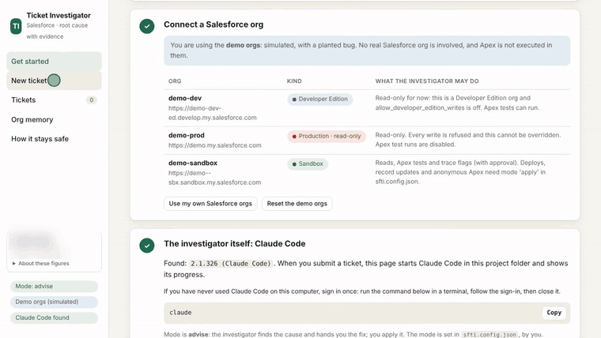

# Salesforce Ticket Investigator

[](https://github.com/PaulZouein/Salesforce-Project/actions/workflows/tests.yml)

Paste a Salesforce bug ticket, or upload it as a PDF. Claude Code investigates it in your org and
hands you back the root cause **with its evidence** (a file and line, a saved query result, a
debug log line), the smallest correct fix as a diff with a test plan, and a comment ready for the
ticket.

**Production orgs are read-only:** that is enforced in code, with no override. **Nothing is
posted** to your ticket system: you get drafts. Everything runs on your computer, on **Windows
and macOS**.

[](docs/demo/real-investigation.mp4)

*A real investigation on the simulated demo orgs: from the ticket to a confirmed root cause in 82
seconds, for about $0.29 at API prices. Click the picture for the whole run, narrated (2 minutes, with sound).*

## Try it in five minutes

1. **Get it.** On GitHub, **Code → Download ZIP**, and unzip it anywhere. Or:
   `git clone https://github.com/PaulZouein/Salesforce-Project.git`
2. **Start it.** Double-click `start.bat` (Windows) or `start.command` (macOS): the one file to
   run. The first start installs what it needs into a private `.venv` folder (about a minute,
   once). Then the page opens in your browser. No Salesforce org at hand? Click **Try with the
   demo orgs** on the page.
3. **New ticket → Load the sample ticket → Save and continue.** Then either:
   - **Replay the recorded sample**: free, a few seconds, the result of a real earlier run; or
   - **Investigate with Claude Code**: a real investigation, a few minutes. It uses your Claude
     usage: $0.26 to $0.77 at API prices on the sample ticket, shown live on the page.

You need **Python 3.11 or newer**, and for a real investigation **Claude Code**, signed in
(installed with `npm`, which comes with [Node.js](https://nodejs.org/)). The demo needs no
Salesforce account and no Salesforce CLI: its three orgs are simulated, with a planted bug, and
they do not execute Apex. [`QUICKSTART.md`](QUICKSTART.md) is the one-page version, with what to
do when something is missing.

## What an investigation does

1. **Reads the whole ticket**, comments included, and lists what is ambiguous.
2. **Starts from what it knows about the org**: a local memory of earlier investigations, checked
   against the org before it is trusted.
3. **Ranks hypotheses**, each with what would confirm it and what would rule it out.
4. **Gathers evidence**: retrieves only the components a hypothesis needs, traces what runs on
   the object, queries the affected records (personal data redacted), reads debug logs, checks
   what changed recently.
5. **States the root cause** with its chain of evidence, or says *Not confirmed* and lists exactly
   what is missing. A guess is labelled *Hypothesis*.
6. **Proposes the smallest correct fix** as a diff, in the layer the org already uses, with impact,
   risks and a test plan.
7. **Writes the report and a ticket comment.** Every citation is checked against the saved files
   before the report is accepted; the comment uses record Ids, never names or e-mail addresses.

In `apply` mode, and with your approval for each step, it can also deploy the fix to a sandbox,
run the tests and roll back if the fix does not hold (see *The two modes* below).


## How it stays safe

- **Production is read-only.** Every Salesforce CLI command is classified: anything that is not
  on the read list needs a permit, and only the guard issues one, after asking the org itself
  whether it is production. No setting, flag or instruction changes that.
- **Every write asks you, every time.** Investigations started from the page get no write tools
  at all.
- **Nothing is posted anywhere.** Reports and comments are drafts you post yourself.
- **No personal data in reports or comments.** Query results are redacted when they are saved.
- **Your data stays on your computer.** Tickets, evidence and the org memory are local folders,
  never committed or uploaded. What leaves your computer is what Claude Code sends to Claude to
  do the work.
- **Claude Code never runs the Salesforce CLI itself.** A hook blocks it; the tools are the only
  way in.

How each layer works, and what it does not guarantee: [`docs/SAFETY.md`](docs/SAFETY.md). To
report a vulnerability: [`SECURITY.md`](SECURITY.md).

## Use it with your own orgs

1. Install the Salesforce CLI: `npm install --global @salesforce/cli`.
2. Double-click `start.bat` (Windows) or `start.command` (macOS), not the demo. **Get started**
   has a **Log in with your browser** button for your kind of org (it runs
   `sf org login web --alias my-sandbox ...` for you). You log in to Salesforce in your own
   browser; the investigator never sees your password. No
   browser on the computer that runs it? The page can take an authorization pasted from one that
   has ([guide](docs/GUIDE.md#what-the-page-can-and-cannot-do)).
3. **New ticket**: paste the ticket or upload its PDF, and choose the org where it happens.

Have a Developer Edition org to spare? [`docs/LIVE-ORG.md`](docs/LIVE-ORG.md) checks every tool
against it, read-only, and can plant the sample bug there to investigate for real.

## What you get

| Piece | What it is |
|---|---|
| `core/` | All Salesforce logic, every safety check, and the org memory. Standard library only. |
| `mcp_server/` | The `sf-investigator` MCP server: the 36 read-only and 6 write tools Claude Code calls (MCP is how Claude Code talks to tools). |
| `webapp/` | The local web page (`python -m webapp`). Standard library only. |
| `.claude/` | Five skills (get started, intake, investigate, propose fix, write comment), a read-only `code-tracer` subagent, permission settings and a guard hook. |
| `CLAUDE.md` | The rules the assistant follows in this folder. |
| `simulator/` | A stand-in for the `sf` executable backed by files, with three simulated orgs. It powers the tests and the demo. It does not execute Apex. |
| `samples/` | A sample ticket (`DEMO-101`), the planted bug behind it, and the reports real investigations produced. |
| `tests/` | 981 tests. They need no org and no Salesforce CLI. |

Each ticket gets its own folder, `tickets/<KEY>/`, which is never committed:

```
tickets/<KEY>/
  ticket.md        structured intake
  attachments/     files you drop in
  metadata/        SFDX project with its own git repository (every retrieve is a commit)
  queries/         saved query and test results (always redacted)
  logs/            downloaded debug logs
  apex/            anonymous Apex scripts and their logs (apply mode)
  fix.diff         proposed change
  report.md, report.html, comment.md
```

## The two modes

The mode is the `mode` key in `sfti.config.json`. **You** change it; the assistant is not allowed
to edit that file. It is re-read on every operation, so no restart is needed.

| Mode | What the assistant does |
|---|---|
| `advise` (default) | Finds the root cause and hands you the fix as a diff with a test plan. You implement it. The only write available is `set_trace_flag` (it turns on a debug log for one user), on a non-production org, with your approval. |
| `apply` | The same, and then, with your approval for every single write: deploys to a non-production org, runs tests, re-checks records or logs, iterates, and rolls back if the fix does not hold. |

Investigations started from the web page advise only, whatever the mode: they are not given the
write tools. Applying a fix is done in Claude Code in the terminal (`start.bat --claude` or
`sh start.command --claude`), where each write asks you.

All settings, with their defaults (a key you leave out takes its default):

```json
{
  "mode": "advise",
  "allow_developer_edition_writes": false,
  "allow_apex_tests_on_production": false,
  "default_row_limit": 50,
  "max_row_limit": 200,
  "jira_base_url": ""
}
```

- `allow_developer_edition_writes`: Developer Edition orgs report `IsSandbox = false`. They are
  read-only unless you set this to `true`.
- `allow_apex_tests_on_production`: Apex test runs are refused on production. Setting this to
  `true` enables one separate tool, `run_apex_tests_on_production`, which asks for approval every
  time. It enables test runs only. It does not enable any write.
- `default_row_limit`, `max_row_limit`: a query without `LIMIT` gets the default; a `LIMIT` above
  the maximum is rejected. The maximum cannot be set above 2000.
- `jira_base_url`: see [reading tickets from Jira](docs/GUIDE.md#optional-reading-tickets-from-jira).
  Empty means off.

A file that cannot be read, or a value of the wrong type, falls back to the safe defaults, and
`get_config` reports the problem. Nothing in this file can enable writes on production.

## What has been verified, and what has not

- **Verified:** the 981 tests on Windows and macOS in CI, through the real subprocess path,
  against the simulated orgs; every Salesforce CLI command, flag and result shape the tool uses,
  against the installed CLI 2.158.7 and its sources; complete AI investigations started from the
  page; the release zip setting itself up from nothing on Windows and macOS.
- **Reviewed:** two rounds of independent review (safety, correctness, Salesforce behaviour), each
  finding reproduced as a failing test and then fixed; decisions 80 to 114 in
  [`docs/DECISIONS.md`](docs/DECISIONS.md) list them, with the few gaps left on purpose.
- **Not yet verified:** a real Salesforce org (none was reachable while it was built;
  [`docs/LIVE-ORG.md`](docs/LIVE-ORG.md) is how to check), Apex execution (the simulated orgs do
  not run Apex), and a real Windows or macOS desktop: the double-click and the system's warning
  for a downloaded script (CI covers the install and the page answering).

The full list: [`docs/VERIFICATION.md`](docs/VERIFICATION.md).

## Documentation

| | |
|---|---|
| [`QUICKSTART.md`](QUICKSTART.md) | One page: from nothing to a first result. |
| [`docs/WALKTHROUGH.md`](docs/WALKTHROUGH.md) | Every step with a screenshot, and a three-minute video. |
| [`docs/GUIDE.md`](docs/GUIDE.md) | The web page, costs and using fewer tokens, PDF tickets, the org memory, your own orgs, Jira, troubleshooting. |
| [`docs/SAFETY.md`](docs/SAFETY.md) | The safety model, the permission settings and the guard hook. |
| [`docs/REFERENCE.md`](docs/REFERENCE.md) | Every tool, calling one from the command line, using `core/` elsewhere, the tests. |
| [`docs/VERIFICATION.md`](docs/VERIFICATION.md) | The DEMO-101 demonstration, and what was verified and how. |
| [`docs/LIVE-ORG.md`](docs/LIVE-ORG.md) | Trying it on your own Developer Edition org. |
| [`docs/DECISIONS.md`](docs/DECISIONS.md) | Every design decision, and why. |
| [`CLAUDE.md`](CLAUDE.md) | The rules the assistant follows in this folder. |
| [`SECURITY.md`](SECURITY.md) | How to report a vulnerability. |
