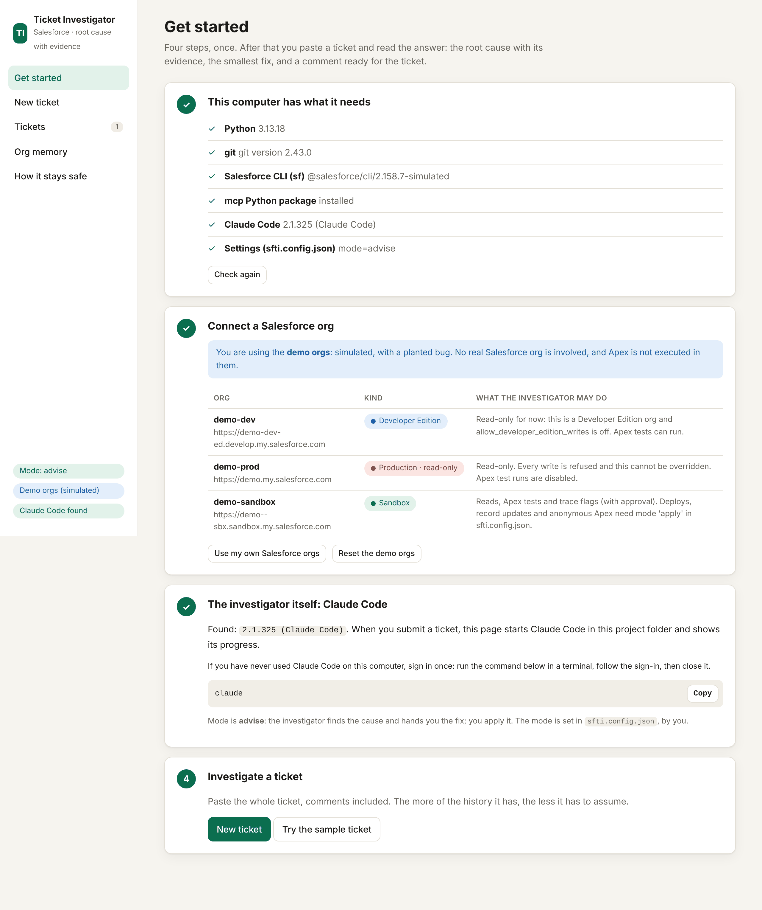
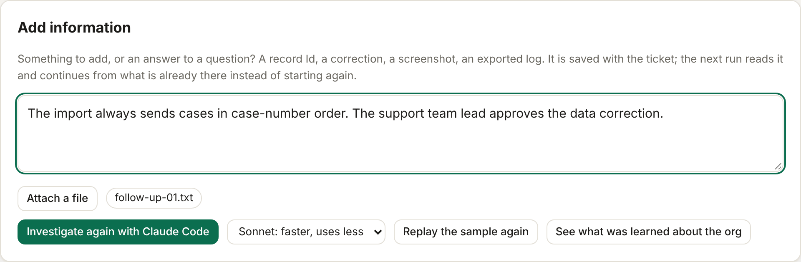
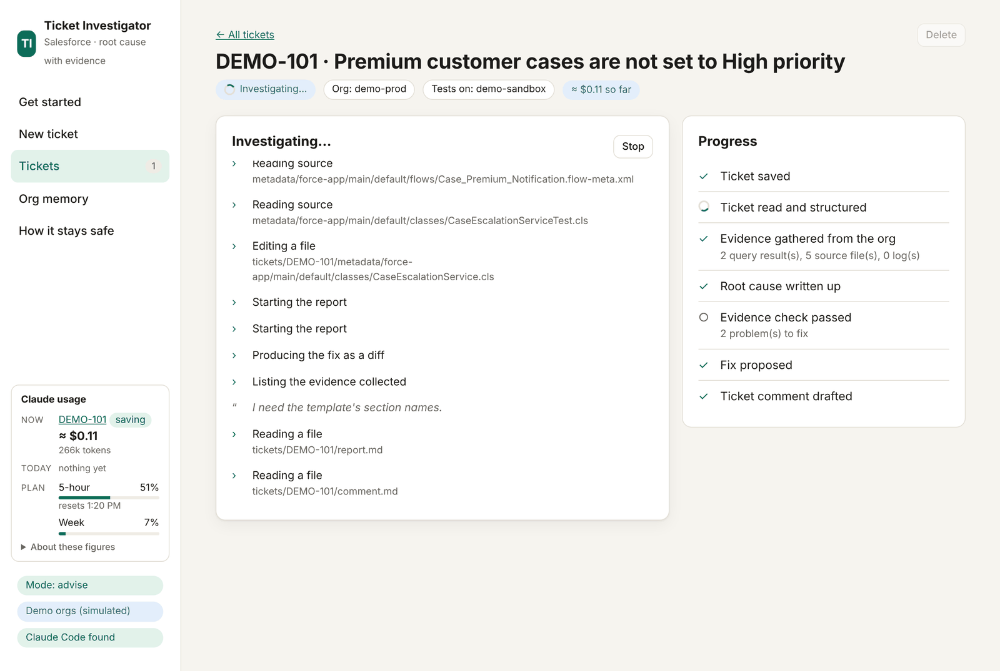
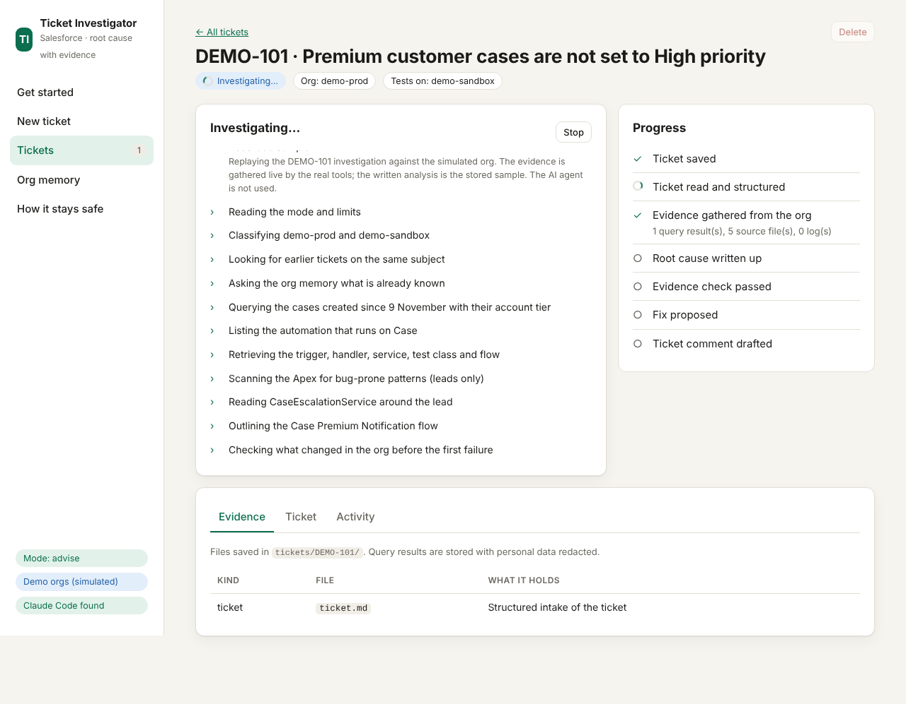
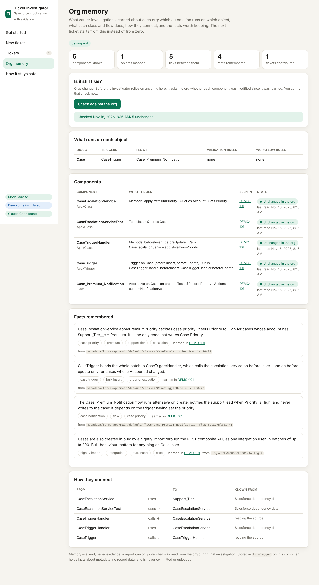

# Guide

How to use the Salesforce Ticket Investigator day to day: the web page, what an investigation costs,
the org memory, your own orgs, Jira, and what to do when something does not work. Start with the
[README](../README.md) or [QUICKSTART.md](../QUICKSTART.md) if you have not run it yet.

- [The web interface](#the-web-interface)
- [Org memory: it learns your org](#org-memory-it-learns-your-org)
- [Try the demo from a terminal, without the page](#try-the-demo-from-a-terminal-without-the-page)
- [Set it up for a real org](#set-it-up-for-a-real-org)
- [Optional: reading tickets from Jira](#optional-reading-tickets-from-jira)
- [Troubleshooting](#troubleshooting)

## The web interface

```
python -m webapp            # your real Salesforce CLI and orgs
python -m webapp --demo     # simulated demo orgs, no Salesforce account needed
python -m webapp --port 9000 --no-browser
```

It opens `http://127.0.0.1:8765/`, or the next free port when another program uses that one (the
address is printed). Starting it a second time opens the copy that is already running instead of
a second one on the same tickets. Stop it with Ctrl+C. The `start` scripts do the same after
setting up a private Python environment in `.venv`; `start.bat --claude` / `sh start.command
--claude` open Claude Code in the folder with the investigator's tools, for working in the terminal,
and `--demo` starts on the demo orgs.

| Page | What you do there |
|---|---|
| **Get started** | Four steps. It checks Python, git, the Salesforce CLI and Claude Code and, for anything missing, shows the command that installs it on your system. It lists your connected orgs with what each one is (production, sandbox…). To connect one, you type a name, pick the kind of org, and copy the exact `sf org login web …` command it builds. |
| **New ticket** | Paste the ticket as it is, comments included, or **upload it as a PDF** exported or printed from Jira. The key is found in the text. Choose the org where the problem happens, a sandbox for tests if you have one, the model, and whether to **use fewer tokens**. |
| **The ticket page** | Start the investigation and watch it: each step in plain words ("Querying records", "Reading source", "Checking the report's evidence"). Then the result: the root cause and whether it is confirmed, the evidence check, and tabs for the cause with its evidence chain, the fix as a diff with the test plan, the full report, the draft comment with a copy button, the saved evidence files, and the ticket as it was read. The investigator's open questions are shown at the top; **Add information** takes your answer, a correction or a file and runs again from what was found; **Download the result** gives the report, the comment and the fix as one zip. |
| **Tickets** | Everything investigated on this computer, with status and root-cause state. |
| **Org memory** | What has been learned about each org, a search box that asks it what the investigator would ask, and a button to check it against the org. See below. |



### How an investigation runs from the page

The investigation itself is done by Claude Code. The page has three ways to get there:

1. **Investigate with Claude Code.** The page starts Claude Code in the project folder without a
   terminal (`claude -p`, with the ticket's instructions on standard input) and shows its
   progress. It uses your Claude Code sign-in and usage. The sample ticket took two minutes with
   Sonnet; a real ticket on a real org takes longer.
2. **Run it yourself.** The page shows one prompt to paste into Claude Code. The result appears
   on the page as the files are written, because the page reads the ticket's folder.
3. **Replay the recorded sample** (demo orgs, sample ticket only). Shows a complete result in
   seconds without the AI: the real tools gather the evidence from the simulated org, and the
   written analysis is the stored sample. The page labels it as a recorded sample.

**What Claude Code is given when the page starts it.** The page spells it out on the command
line, so it does not depend on how Claude Code is set up on your computer, and the folder does
not have to be opened in Claude Code first. You only need to be signed in (`claude` once in a
terminal).

- Only this project's own tool server (`sf-investigator`) is attached. Connectors you use in
  Claude Code for other things are not available to the investigation.
- The read-only investigator tools are allowed by name, taken from the server's own list.
- The six tools that change an org are removed, together with the shell and web access.
- Of Claude Code's own tools it gets only those an investigation uses: reading, searching and
  writing files, loading the investigator's tools, and helper agents. Every other tool's
  description would be sent with each step; leaving them out took the starting context from
  41,300 tokens to 11,600 in a measurement.
- It may write files, which it needs for the ticket's folder. The project's rules still refuse
  edits to the safety files.

**From the page the investigator only advises**, whatever the mode in `sfti.config.json`. You get
the fix as a diff. To have it deployed to a sandbox and tested, use Claude Code itself in `apply`
mode (`start.bat --claude`), where each write asks you.

**Choose the model** next to the Investigate button: Claude Code's default, Sonnet (quicker,
uses less of your Claude usage) or Opus. `SFTI_CLAUDE_MODEL` sets the default for every ticket.

**Add information and run again.** An investigation nobody watches cannot ask you anything, so
what it would have asked comes back as *Open questions*, shown at the top of the result. Write
your answer, a correction or a record Id under **Add information**, attach a screenshot or an
exported log (text, CSV, JSON, XML, images, PDF; 5 MB each), and press *Investigate again*. Notes
and files are saved in the ticket's `attachments/` folder. The next run reads them and continues
from what is already there instead of starting again: in the recorded follow-up of the sample it
re-queried what the answer changed, cited the answer as what the user said, dropped the
hypothesis it settled and kept the one it did not.



A run that ends without writing a report is shown as *Stopped before the report*, not as done.

### What an investigation costs, and using fewer tokens

**The usage box** is on every page: in the sidebar on a computer, a small pill at the bottom on a
phone. While an investigation runs it shows what it has used so far, in tokens and as an
estimated price, and updates every second or two. Below that: the last run, today's total, and
your plan's limits.



- **The price** is estimated from the tokens Claude Code reports for each step, at Anthropic's
  API list prices. When the run ends, Claude Code reports its own total, which replaces the
  estimate (on two recorded runs the estimate was within 1 to 4 percent of it). With a Claude
  subscription you are not charged per token: the figure tells you what the run would cost at
  API prices, and the run counts toward your plan's limits.
- **Plan** shows the share of your 5-hour and weekly limits already used, as Claude Code reports
  it during a run. It appears after the first run and is shown as of then.
- Each finished run is kept in `usage/ledger.jsonl` on this computer (ticket key, tokens, price,
  settings; nothing else). Runs you start yourself in Claude Code are not counted here; use
  `/cost` or `/usage` there.

**Use fewer tokens** (a tick box on New ticket and next to the Investigate button) changes four
things for that ticket:

| What | Why it saves |
|---|---|
| Sonnet, unless you chose a model | a lower price per token |
| Medium effort instead of Claude Code's default | less deliberation and fewer, larger steps |
| No helper agents, and no list of every skill on your computer | a helper agent starts a fresh context and reads again what the main run read; the skill list is sent with every step |
| The 5-minute prompt cache instead of the 1-hour one | on a subscription Claude Code keeps the context cached for an hour, and writing it then costs twice the input price instead of 1.25 times; an unattended run never pauses long enough to need the hour |
| An instruction to economise: make independent calls together, read only what a hypothesis needs, read each file once, write short | fewer steps, smaller context |

The evidence rules do not change: every claim still needs an artifact, and the report must still
pass the evidence check. Measured on the sample ticket, one run each:

| Run of the sample ticket (Sonnet) | Cost | Steps | Result |
|---|---|---|---|
| Three runs without the option | $0.44 to $0.77 | 39 to 58 | root cause confirmed |
| With the first version of the option (without the 5-minute cache, and with all of Claude Code's tools) | $0.51 | 13 | confirmed, evidence check passed |
| With the option as it is now | **$0.26** | 15 | confirmed, evidence check passed (8 citations) |

The first version took fewer steps but cost about the same, because most of the price was
context written to the cache: 82,000 tokens at twice the input price. Trimming Claude Code's
tools (now done for every run from the page) and the 5-minute cache halved that. The cost of a
run varies from one run to the next, so these are indications, not averages. Runs without the
option also start from the trimmed tool list now; that was not measured separately.

**Stop if it costs more than $…** sets a spending limit for each run. Claude Code stops the run
when it is reached; the page says *Stopped at your spending limit*, keeps what was found, and
*Continue* goes on from there.

### A ticket as a PDF

**Upload a PDF** on New ticket takes a PDF of the ticket, exported or printed from Jira. Its text
fills the form so that you can check it; the PDF itself is kept with the ticket
(`attachments/ticket-original.pdf`), and the investigator is told to open it for what the text
loses, such as tables or screenshots. For a scanned PDF without text, type the key: the
investigator reads the PDF itself. Up to 10 MB; the first 80 pages are read as text.



### What the page can and cannot do

- It answers only on this computer: it binds to `127.0.0.1`, refuses requests addressed to any
  other host name, and requires a token embedded in the page for anything that changes state.
  There is no option to expose it on the network. Do not put it behind a public proxy. The one
  exception is a name you allow on purpose, `--allow-host NAME` (one exact name, repeatable), for
  a proxy you trust in front of it, such as the preview of a cloud session. Names it refused are
  printed in its window, so you can see what to allow.
- It has **no route that changes a Salesforce org**. It reads (orgs, tickets, memory), creates
  and deletes ticket folders on your disk, starts investigations, and can save an org's
  authorization on the computer it runs on (below). A test scans its code for any reference to
  the write functions.
- **Connecting an org without a browser.** Where the page runs on a computer you cannot log in
  from (a remote machine, a cloud session), *Get started → Connect an org → No browser on the
  computer that runs the investigator?* takes an authorization instead. On a computer that has
  the Salesforce CLI and a browser, run `sf org login web --alias my-dev`, then
  `sf org auth show-sfdx-auth-url --target-org my-dev`, and paste the line that starts with
  `force://` into the page. That line works like a password: paste it only there. The page
  hands it to `sf org login sfdx-url` on standard input, so it never appears in a command line,
  a log, an answer or an error; it stores nothing itself. The Salesforce CLI 2.158 has no
  code-based (device) login any more, which is why this takes an authorization rather than a code.
  To end it: `sf org logout --target-org my-dev` on the computer that runs the page, and revoke
  the Salesforce CLI under your user's OAuth Connected Apps in Salesforce.
- It posts nothing to your ticket system. The comment tab is a draft with a copy button.
- **Download the result** contains the report (Markdown and printable HTML), the comment, the fix
  and the ticket summary. The saved evidence, the retrieved source and the pasted ticket stay in
  the ticket's folder.
- It remembers for a moment what takes seconds to ask (the org list, what kind of org each one
  is, the set-up checks). That is for display only: before every write the guard asks the org
  itself. *Check again* and *I have connected it* ask afresh.
- Pasted ticket text is stored as you pasted it in `tickets/<KEY>/attachments/`, on your disk
  only. The structured `ticket.md`, the report and the comment are written without personal data.

## Org memory: it learns your org

Every investigation reads parts of an org. The investigator keeps what it saw, so the next ticket
on the same org starts from knowledge instead of from zero.

**What is remembered**, per org, in `knowledge/<org id>.json` on your computer:

| | Where it comes from |
|---|---|
| **Components**: every class, trigger and flow that was retrieved, with what it does: its methods, the objects it queries, the fields it sets, what it calls; for a flow, when it runs and which fields it tests or writes | Automatically, each time source is retrieved |
| **Objects**: which triggers, flows, validation rules and workflow rules run on each object | Automatically, when the automation on an object is listed |
| **Links**: which component calls or uses which | Automatically, from the source and from Salesforce's dependency data |
| **Facts**: short notes such as "CaseEscalationService decides case priority from the account's support tier" or "cases are also created in bulk by a nightly import", with topics and the file they were read from | Written by the investigator at the end of a ticket |

**How it is used.** At the start of a ticket the investigator asks the memory about the ticket's
subject ("voice calls", "case priority"…). It gets back the components and facts that relate, and
goes to them first instead of rediscovering the org.

**The double check.** Orgs change, so nothing is trusted because it was true last month:

- When memory is recalled, the org is asked for the current last-modified date of every
  remembered component involved. Anything modified since it was learned is flagged **changed**,
  the facts about it are flagged **needs re-reading**, and the investigator reads it again.
- When source is retrieved, it is compared with what was remembered. A difference is reported
  ("changed since last seen in ticket ABC-12") and the memory is updated.
- A component that no longer exists is reported as such.
- **Memory is a lead, never evidence.** A report may only cite what was read from the org during
  that investigation. The memory decides where to look first; it never appears as proof.

**Earlier tickets.** A recall also lists the earlier tickets that touched the same components,
with the status and the first paragraph of what each concluded. It is a lead like the rest: a
similar symptom can have a different cause.

**Two programs, one memory.** The tool server and the web page both write the memory file. Each
change takes a per-org lock, reads, changes, saves and releases, so neither undoes what the
other learned. A lock left by a crashed program is taken over after a minute.

**What it does not hold:** no record data, no personal data (a note containing an email address
is refused), no conclusions about individual tickets. It is keyed by org Id, not by alias, so
re-pointing an alias does not mix two orgs. The folder is never committed or uploaded.

The **Org memory** page shows all of it, with a search box and a "Check against the org" button. In Claude Code
the tools are `recall_org_knowledge`, `org_map`, `verify_org_knowledge`, `remember_org_fact` and
`forget_org_fact`.



Limits to know: the change check uses last-modified dates for Apex classes, triggers and flows;
other component types are compared only when they are retrieved again. The "what it does"
outline is read from the source text with simple rules, so it can miss things (dynamic calls,
for instance). Both are reasons the memory is treated as a lead.

## Try the demo from a terminal, without the page

The quickest way is the page: double-click `start.bat` or `start.command`, then **Try with the
demo orgs** (see the [README](../README.md)). This is the same demo driven from Claude Code in a terminal.


You need Python 3.11 or newer, git and Claude Code. The simulated orgs contain a planted bug and a
ticket about it.

**1. Install.** From the project folder:

macOS:

```bash
python3 -m venv .venv
source .venv/bin/activate
python -m pip install -e .
```

Windows (PowerShell):

```powershell
py -m venv .venv
.\.venv\Scripts\Activate.ps1
python -m pip install -e .
```

**2. Create the simulated orgs.**

```
python -m simulator setup
```

It prints the path of a launcher and the line to set `SFTI_SF_EXECUTABLE`. Set it in the same
terminal:

macOS:

```bash
export SFTI_SF_EXECUTABLE="$PWD/simulator/state/bin/sf"
```

Windows (PowerShell):

```powershell
$env:SFTI_SF_EXECUTABLE = "$PWD\simulator\state\bin\sf.cmd"
```

**3. Check the prerequisites.**

```
python -m core.prereqs
```

Every line should say `OK`. The Salesforce CLI line shows `…-simulated` and three orgs are listed:
`demo-sandbox`, `demo-prod`, `demo-dev`.

**4. Start Claude Code from the same terminal**, in this folder, so that it inherits the virtual
environment and `SFTI_SF_EXECUTABLE`:

```
claude
```

Approve the `sf-investigator` MCP server when asked. `/mcp` should show it as connected.

**5. Paste the sample ticket.** Open `samples/DEMO-101/ticket.txt`, copy all of it, paste it into
Claude Code and add: *"New ticket. Investigate it on demo-prod; demo-sandbox is available."*

The assistant should save `tickets/DEMO-101/ticket.md`, summarize the ticket back with its
ambiguities, investigate, and produce `report.md`, `report.html`, `comment.md` and `fix.diff`.
Compare them with `samples/DEMO-101/expected/`.

When you are done, unset `SFTI_SF_EXECUTABLE` (or open a new terminal) to go back to the real
Salesforce CLI.

## Set it up for a real org

**1. Prerequisites.**

| Need | Check | Install |
|---|---|---|
| Python 3.11+ | `python --version` | python.org, or your package manager |
| git | `git --version` | git-scm.com |
| Salesforce CLI | `sf --version` | `npm install --global @salesforce/cli` |
| Claude Code | `claude --version` | see the Claude Code documentation |

**2. Install the project** as in step 1 of the section above (`python -m pip install -e ".[dev]"`).

**3. Tell the project which Python to use, if needed.** `.mcp.json` starts the server with
`${SFTI_PYTHON:-python}`, and the guard hook uses the same variable.

- If you start Claude Code from a terminal where the virtual environment is active, `python` is
  the right one and you have nothing to set.
- Otherwise set `SFTI_PYTHON` to the full path of the environment's interpreter, for example
  `export SFTI_PYTHON="$PWD/.venv/bin/python"` (macOS) or
  `$env:SFTI_PYTHON = "$PWD\.venv\Scripts\python.exe"` (Windows).
- On a Mac that only has `python3`, set `SFTI_PYTHON=python3`.

**4. Log in to your orgs** with the Salesforce CLI, in your own terminal (the assistant never runs
`sf` itself):

```
sf org login web --alias my-sandbox --instance-url https://test.salesforce.com
sf org login web --alias my-prod
```

Log in to production with a user that has only the access the investigation needs. The tool
never writes to production, but a read-only or minimum-access user is still the right habit.

No browser on the computer that runs the investigator? See *Connecting an org without a
browser* under *What the page can and cannot do*.

**5. Check.**

```
python -m core.prereqs
```

**6. Start Claude Code in this folder** and paste a ticket. Tell it which org alias to use.

### How to try each part

| Part | Ask the assistant | What to look for |
|---|---|---|
| Guards and org check | "Which orgs do I have, and which are production?" | `org_info` reports the classification and `writes_allowed` |
| Intake | Paste a ticket | `tickets/<KEY>/ticket.md`, a summary, a list of ambiguities, at most a few questions |
| Read-only investigation | "Investigate it on `<alias>`" | Hypotheses, then queries, retrieved source, logs; files under `queries/`, `metadata/`, `logs/` |
| Report | (follows the investigation) | `report.md` passes `validate_report`; every claim has an E-number; `comment.md` |
| Fix proposal | "Propose the fix" | `fix.diff`, rationale, impact, risks, test plan. Nothing is deployed |
| Apply and verify | Switch to apply mode (below), then "apply it on `<sandbox alias>`" | A prompt for each write; validate, deploy, tests, re-check, rollback on request |

## Optional: reading tickets from Jira

Off by default. Pasting the ticket is the normal path.

**Jira Server / Data Center.** One read-only tool, `jira_get_ticket`, fetches a ticket's fields
and comments with a single `GET` request. To enable it:

1. Add `"jira_base_url": "https://jira.your-company.example"` to `sfti.config.json` (https only).
2. Create a personal access token in Jira and export it as `SFTI_JIRA_TOKEN` before starting
   Claude Code. The token is read from the environment only; it is never written to a file, a
   result or an error message.

People come back as roles (`reporter`, `commenter-1`), and email addresses and mentions in the
text are masked, because the text ends up in `ticket.md`. Attachments are listed, not downloaded.
There is no tool that comments on, edits or transitions a ticket, and the module can only send
`GET`. It was not tested against a real Jira instance.

**Jira Cloud.** Use Atlassian's own remote MCP server and connect it to Claude Code following
Atlassian's current documentation; this project does not wrap it. If you connect it, keep its
write tools (create, edit, comment, transition) out of the `allow` list so that they ask, or deny
them: rule 8 in `CLAUDE.md` says the assistant drafts and you post.

## Troubleshooting

| Symptom | Cause and fix |
|---|---|
| `/mcp` shows `sf-investigator` as failed | The server could not start. Run `python -m mcp_server` in the same terminal: an import error means the project is not installed in that Python (`python -m pip install -e .`), or `SFTI_PYTHON` points at another interpreter. |
| "The Salesforce CLI ('sf') was not found on PATH" | Install it, reopen the terminal, and start Claude Code from that terminal. Or set `SFTI_SF_EXECUTABLE` to the full path (`sf.cmd` on Windows). |
| "That org is not authenticated on this machine" | `sf org login web --alias <alias>` in your terminal, then `list_orgs`. |
| A sandbox is reported as production | The classification failed closed. `org_info` shows the reason: the Organization record could not be read, or `IsSandbox` was not a boolean. Check the user's access to the Organization object and re-authenticate. |
| `write_mode_disabled` | The tool is in advise mode. Set `"mode": "apply"` in `sfti.config.json` yourself if you want it to deploy. |
| `developer_edition_write_blocked` | Set `"allow_developer_edition_writes": true` yourself. A Developer Edition org with a namespace (the org that holds a managed package's source) stays read-only whatever the setting says. |
| `production_write_blocked` | Final. Reproduce and fix in a sandbox. |
| `org_drift` on deploy | The org's version changed since it was retrieved. The current version is now committed in `tickets/<KEY>/metadata/` and your edit is still in the working tree. Review the difference, then deploy again. |
| `deploy_in_progress` | The deploy was still running in the org when the wait ran out, so it may still change the org. It is recorded as `in_progress`. Do not deploy again yet: check **Setup > Deployment Status**. Once it has finished, `rollback_change` can undo it: it reads the components from the org first, and does nothing while the org still holds the version from before. |
| `deploy_failed`: "Nothing was deployed: the org's current version could not be retrieved first" | The snapshot a rollback would need could not be taken, so the deploy stopped before changing anything. Retry when the retrieve works again. |
| A rollback "did not complete" | It can be called again for the same change: a change whose rollback failed stays eligible. |
| "contains characters that cmd.exe interprets" (Windows) | An argument contains one of `& | < > ^ % " !`. Usually the project path. Move the project to a path without those characters. |
| A query is rejected for its `LIMIT` | Narrow the `WHERE` clause; raise `max_row_limit` only if you must. |
| The hook blocks an innocent command | See the known false positive above. Rephrase the command, or run it yourself. |
| A hook error is shown on every tool call | `python` (or `SFTI_PYTHON`) does not run in the shell Claude Code uses for hooks. Set `SFTI_PYTHON` to the full path of your interpreter and restart Claude Code. The error does not block the call. |
| Every tool call is blocked right after pulling | The hook cannot lock a session by design. If it happens, check that `.claude/hooks/guard.py` exists and that `python` (or `SFTI_PYTHON`) runs; then report it. To get out, run `python scripts/generate_settings.py --no-guard` in your own terminal. |
| You want to start a ticket again | Delete `tickets/<KEY>/` yourself, or use **Delete** on the ticket's page. |
| The investigation stops with a sign-in message | Run `claude` once in a terminal and sign in. |
| "Stopped at your spending limit" | The run reached the limit you set. Raise or clear the limit next to the Investigate button and start it again: it continues from what it found. |
| "Reading PDF files needs the pypdf package" | The project was installed before PDFs were supported. Start it with its start script again, which installs what is missing. |
| The ticket shows "Stopped before the report" | Claude Code ended without writing one. Open **Activity** for its last message, add what it was missing under **Add information**, and start it again: it continues from what it gathered. |
| The page says "The sf-investigator tools did not start" | Same cause as a failed server in `/mcp`: see the first row. The page starts Claude Code with the Python that runs the page, so start the page with the `start` script, or from the project's virtual environment. |
| `python -m webapp` says it could not listen | Ports 8765 to 8774 are all used by other programs. Use `--port 9000`. |
| The start script says the installation did not finish | No internet connection, or a network that blocks `pypi.org`. Fix that and start again. |
| The page shows a result but the status stays "In progress" | The report or the comment is not written yet. If Claude Code stopped, open the ticket's **Activity** tab for the last step, then start again. |
| The org memory looks wrong | Press **Check against the org** on the Org memory page. To start over for one org, delete its file in `knowledge/`. |
